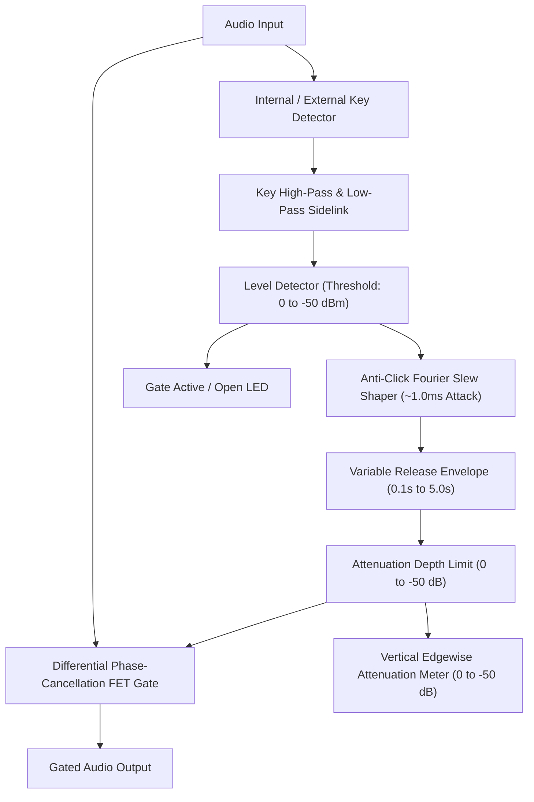

# Ward-Beck Systems M467 Noise Gate & Meter Module - VST/AU Plugin Build Plan

**Module Name:** WBS M467 Noise Gate & Meter Module  
**Hardware Reference:** Ward-Beck Systems M467 / M567 Noise Gate and Meter Module (Drawing `467-02-001`, Card 8-109, December 1976)  
**Target Architecture:** VST3 / AU / AAX / CLAP (C++20 / JUCE 7 / Native Frame Engine)  
**Shared Engine Dependency:** [`wbs::engine::SharedPluginFrame`](file:///home/anthony/Documents/GitProjects/WBSps.ca/2030.env/vst/core/SharedPluginFrame.hpp), [`wbs::engine::VerticalEdgewiseMeterCore`](file:///home/anthony/Documents/GitProjects/WBSps.ca/2030.env/vst/core/BallisticsCore.hpp), [`wbs::engine::NonLinearCore`](file:///home/anthony/Documents/GitProjects/WBSps.ca/2030.env/vst/core/NonLinearCore.hpp)

---

## 1. Hardware Architecture & Circuit Analysis

The **M467** combines a high-speed differential noise gate and downward expander with an upright illuminated vertical edgewise meter module. It was engineered specifically to silence HVAC rumble, street noise, and studio bleed during live broadcast interviews and multitrack tracking:



### Core Hardware Features
1. **Differential Phase-Cancellation FET Gate Topology:**
   - Uses a precision matched differential amplifier pair. A field-effect transistor (FET) switches one path. In the "open" state, the circuit operates at pristine unity gain ($0\text{ dB}$). As the gate shuts, the anti-phase path cancels the signal down to $-50\text{ dB}$, eliminating feedthrough and distortion.
2. **Anti-Click Fourier Attack Slew Shaper:**
   - Factory tuned to $\approx 1.0\text{ ms}$. Ward-Beck documentation notes that faster raw rectangular gating produces "an audible Fourier click" on low-frequency transients; the M467 shapes the envelope with a smooth cosine/Butterworth turn-on ramp.
3. **Upright Vertical Edgewise Meter:**
   - Positioned in the upper half of the $1.6\text{-inch}$ channel card. Shows real-time gate attenuation down to $-50\text{ dB}$ (or switchable to audio output level).
4. **Key Filtering & External Sidechain:**
   - Switchable internal/external keying with dedicated high-pass and low-pass sidechain filters.

---

## 2. DSP Mathematical Specification

### 2.1 Smooth S-Curve Gain Attenuation
To replicate the FET phase-cancellation gate without digital clicks:
$$g[n] = 1.0 - \text{Depth} \cdot \frac{1.0}{1.0 + \exp\left(\frac{L_{key}[n] - T_{gate}}{\sigma}\right)}$$
where $\text{Depth} \in [0.0, 1.0]$ corresponds to the selected maximum attenuation ($0\text{--}50\text{ dB}$), and $\sigma$ provides a smooth $1.5\text{ dB}$ transition knee.

### 2.2 Ballistic Envelope Detector
- **Attack Ramp:** 1.0 ms smooth cosine transition.
- **Release Decay:** Logarithmic decay from $0.1\text{ s}$ to $5.0\text{ s}$:
  $$\alpha_{rel} = \exp\left(-\frac{1}{\tau_{rel} \cdot f_s}\right)$$

---

## 3. Parameter Mapping & State Architecture

| ID | Parameter Name | Range | Steps / Type | Default | Unit |
|---|---|---|---|---|---|
| `m467_gate_in` | Gate Active / Bypass | In / Out | Toggle | In | Bool |
| `m467_threshold` | Gate Threshold | $-50.0$ to $0.0$ | Continuous | $-30.0$ | dBm |
| `m467_attenuation` | Max Attenuation Depth | $-50.0$ to $0.0$ | Continuous | $-40.0$ | dB |
| `m467_release` | Release Time | $0.1$ to $5.0$ | Continuous (Log) | $0.5$ | s |
| `m467_attack` | Attack Time | $0.2$ to $10.0$ | Continuous | $1.0$ | ms |
| `m467_key_source` | Key Source | Internal / External Sidechain | Toggle | Internal | Enum |
| `m467_meter_mode` | Vertical Meter Mode | Attenuation / Signal Level | Toggle | Attenuation | Enum |

---

## 4. C++ Plugin Scaffolding

```cpp
#pragma once
#include "SharedPluginFrame.hpp"
#include "BallisticsCore.hpp"

namespace wbs::m467 {

class M467PluginProcessor : public engine::SharedPluginFrame {
public:
    M467PluginProcessor();
    ~M467PluginProcessor() override = default;

    void prepareModule(double hostRate, double oversampledRate, size_t maxBlockSize, size_t numChannels) override;
    void releaseModule() override;
    void updateParametersFromHost() noexcept override;
    void processModuleSlice(engine::AudioBlock& slice) noexcept override;
    void updateMeters(const engine::AudioBlock& audioBlock) noexcept override;

    [[nodiscard]] float getVerticalMeterNeedlePosition() const noexcept;
    [[nodiscard]] bool isGateOpen() const noexcept { return gateOpenState_; }

private:
    engine::VerticalEdgewiseMeterCore verticalMeter_;

    float thresholdDb_{ -30.0f };
    float attenuationDb_{ 40.0f };
    float releaseSec_{ 0.5f };
    float attackSec_{ 0.001f };

    bool gateIn_{ true };
    bool gateOpenState_{ true };
    float currentAttenuationDb_{ 0.0f };
};

} // namespace wbs::m467
```

---

## 5. UI/UX Specification

- **Module Format:** $1.6\text{-inch}$ 460-series vertical console strip.
- **Top Display:** Upright lit edgewise meter ($0\text{ dB}$ at top down to $-50\text{ dB}$ at bottom).
- **Control Bay:** Heavy knurled aluminum rotary knobs for Threshold, Attenuation, and Release.
- **Tally LED:** Bright green LED illuminating when the gate is fully open (signal present).
